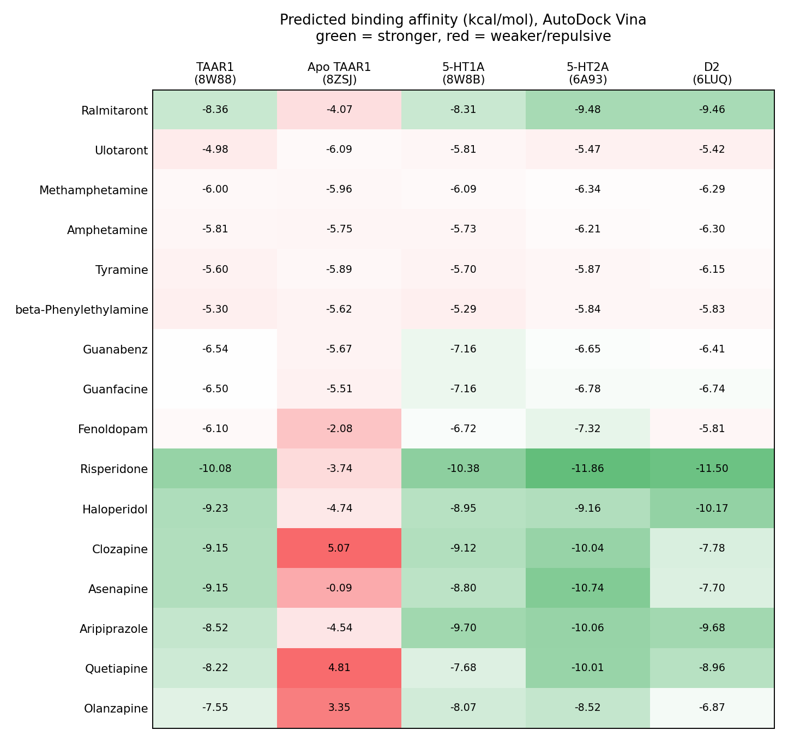
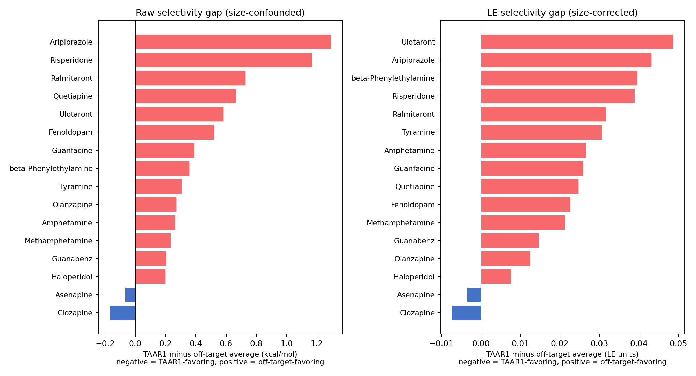

# TAAR1 Selectivity Docking Study

A computational study docking 16 psychiatric drugs against 5 receptor structures — TAAR1 (drug-bound and apo), 5-HT1A, 5-HT2A, and D2 — using AutoDock Vina, to ask whether TAAR1-designed drugs actually show selective binding compared to repurposed antipsychotics.

## Headline result

**After correcting for ligand size, no compound in this 16-drug panel shows clear TAAR1 selectivity.** Raw Vina scores correlate strongly with molecular size (r = -0.907 between heavy-atom count and off-target binding score) — bigger molecules simply score better everywhere, which had been masking the real picture. Once corrected using Ligand Efficiency (score ÷ heavy-atom count), the compounds with the most TAAR1-favoring profile are **Clozapine and Asenapine** — both repurposed antipsychotics, not the TAAR1-designed reference compounds (Ulotaront, Ralmitaront). That is the central, honest finding of this project.

## Results at a glance





Full ranked table, all formulas, and per-compound notes: [`data/FINAL.xlsx`](data/FINAL.xlsx).

## Key findings

1. **The apparent selectivity pattern is largely a ligand-size artifact.** Raw docking scores correlate strongly with heavy-atom count. Correcting with Ligand Efficiency narrows the selectivity signal to a band of -0.007 to +0.049 — too small to call any compound clearly selective. The compound ranking is mostly preserved under this correction (Spearman ρ = 0.81 between raw and corrected rankings), so it is the *magnitude* of the original claim that was wrong, not the whole pattern.

2. **A top score in the homology model was a scoring artifact, not real binding.** Early exploratory docking against a SWISS-MODEL-derived TAAR1 homology model ranked Haloperidol first — but its pose sat 12–18 Å from the residues known to define the real pocket. This was diagnosed via contact-distance analysis, not assumed, and the homology model was excluded from the final matrix as a result.

3. **AutoDock Vina's default settings are not reproducible.** Identical docking setups produced different top-ranked poses across separate runs, traced to Vina's unseeded stochastic search combined with low exhaustiveness. Fixing a random seed (42) and raising exhaustiveness to 32 made results repeatable run to run.

4. **Conformational selectivity between TAAR1's bound and apo states is a real, confirmed effect.** Several bulky antipsychotics that bind strongly to drug-bound TAAR1 score weakly or positively (repulsive) against the empty, apo-state structure. A full seven-step diagnostic on Clozapine ruled out file, box, and protonation errors, and found genuine severe steric overlap (1.85 Å contact with the Val184 backbone, 20+ contacts under 3.2 Å). Full write-up: [`docs/8ZSJ_steric_clash_diagnostic.md`](docs/8ZSJ_steric_clash_diagnostic.md).

5. **The original validation run used a contaminated receptor.** The pipeline was first validated by redocking the native ligand into its own crystal structure (RMSD 0.771 Å). The receptor file used for that run was later found to still contain the co-crystallized ligand, so the figure was treated as unverified. How that run succeeded against such a receptor was not determined. A clean re-validation is described in finding 6.

6. **A repeatable fixed seed can still give a wrong answer.** Ulotaront's top-ranked pose against TAAR1 (seed=42) scored well but sat more than 7 Å from the true crystal position (7.4 Å by nearest-atom RMSD, 9.8 Å by topology-matched RMSD; either way a clear miss). Redocking against the clean receptor *without* a fixed seed recovered the true pose almost exactly (RMSD = 0.669 Å), at a corrected score of **-4.983 kcal/mol**, now used throughout the matrix. Even with this correction, Ulotaront's selectivity gap is the *least* TAAR1-favoring of all 16 compounds — this positive control does not show a TAAR1-selective profile under this metric. Full write-up: [`docs/Ulotaront_seed_investigation.md`](docs/Ulotaront_seed_investigation.md). Ralmitaront, the panel's other TAAR1-designed compound, has not yet been individually re-checked for the same seed issue.

## Limitations

Docking scores are predicted binding affinities, not measured biological activity, and do not replace experimental validation. The D2 structure (6LUQ) was solved at lower resolution (3.1 Å); 55 residues with unresolved side chains were excluded during preparation, though the critical ligand-anchoring residue (Asp114) was confirmed intact. Each receptor uses a single, largely rigid conformation. The TAAR1 homology model was generated by SWISS-MODEL at a single point in time and is included in this repo, since SWISS-MODEL's template database updates over time and rebuilding it later is not guaranteed to reproduce the same structure. Because a fixed seed was shown to fail for one compound (finding 6), the remaining fifteen 8W88 scores have not been individually re-verified for the same issue and should be treated as provisional; Ralmitaront is the highest-priority compound to check next. Ulotaront's 8W88 pose was selected using knowledge of the crystal structure, which is not possible for the other 15 compounds, so that single cell was chosen differently from the rest.

## Repository structure

```
├── data/
│   └── FINAL.xlsx                       # Master results: 16 drugs × 5 receptors, findings, formulas
├── structures/                          # Prepared receptors (PDBQT), native ligands removed
│   ├── Cleaned_8w88_FINAL.pdbqt         # TAAR1, drug-bound (8W88)
│   ├── Cleaned_8ZSJ.pdbqt               # TAAR1, apo (8ZSJ)
│   ├── Cleaned_8w8B_FINAL.pdbqt         # 5-HT1A (8W8B)
│   ├── Cleaned_5-HT2A_FINAL.pdbqt       # 5-HT2A (6A93)
│   ├── Cleaned_D2_FINAL.pdbqt           # D2 (6LUQ)
│   └── Cleaned_homology_model.pdbqt     # SWISS-MODEL TAAR1 homology model (prepared)
├── scripts/                             # AutoDock Vina batch files (.bat)
├── docs/
│   ├── images/
│   ├── 8ZSJ_steric_clash_diagnostic.md
│   └── Ulotaront_seed_investigation.md
├── LICENSE
└── README.md
```

## Methods

- **Docking engine:** AutoDock Vina 1.2.7 (not bundled here; download from [vina.scripps.edu](https://vina.scripps.edu)), seed=42, exhaustiveness=32
- **Receptor prep:** PyMOL for cleaning, Meeko for PDBQT conversion; every receptor checked for residual co-crystallized ligand before use
- **Pocket definition:** derived from the native ligand position where available, or from literature-confirmed key residues for the apo structure, cross-checked against PyMOL's `centerofmass`
- **Structures used:** 8W88 (TAAR1, bound), 8ZSJ (TAAR1, apo), 8W8B (5-HT1A, bound to SEP-363856/Ulotaront), 6A93 (5-HT2A, bound to risperidone), 6LUQ (D2, bound to haloperidol)

Docking boxes (20 × 20 × 20 Å cube for every receptor):

| Receptor | Structure | Center x | Center y | Center z |
|---|---|---|---|---|
| TAAR1 (bound) | 8W88 | 101.59 | 103.70 | 73.01 |
| TAAR1 (apo) | 8ZSJ | 130.65 | 125.46 | 93.61 |
| 5-HT1A | 8W8B | 104.23 | 112.81 | 134.59 |
| 5-HT2A | 6A93 | 13.88 | -0.74 | 60.37 |
| D2 | 6LUQ | 8.995 | 6.744 | -9.667 |

## License

Copyright (c) 2026 Nada Sameh. All rights reserved. This repository is publicly viewable for review purposes only; see the LICENSE file.
